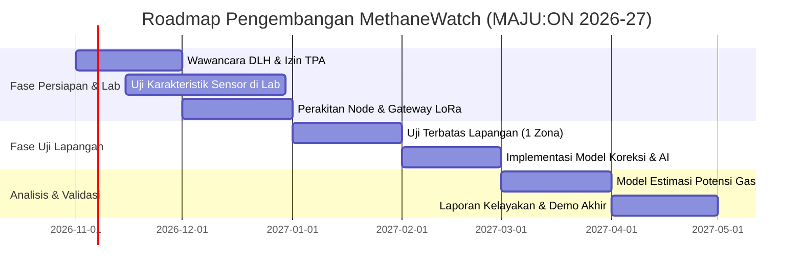

# MethaneWatch 🛰️🔥

> **Prototipe Awal Sistem Pemantauan dan Estimasi Potensi Pemanfaatan Metana TPA Berbasis IoT & AI**  
> Repositori Kerja Tim Mahasiswa Teknik Komputer untuk **MAJU:ON University Track 2026-27**  
> *Tema Fokus:* Climate & Energy &bull; Artificial Intelligence (AI)  
> *Status Proyek:* **Prototipe Awal &bull; Belum diuji di lapangan &bull; Nilai parameter bersifat asumsi sampai diverifikasi**

---

## 📌 1. Ringkasan Proyek

MethaneWatch adalah sistem terintegrasi dua tahap untuk Tempat Pemrosesan Akhir (TPA):

1. **Tahap 1 (Ukur):** Jaringan node sensor nirkabel berdaya rendah bertenaga surya dengan komunikasi LoRa memetakan sebaran konsentrasi gas metana ($\text{CH}_4$), memantau tren temporal, dan memberikan peringatan keselamatan dini di area TPA.
2. **Tahap 2 (Manfaatkan):** Dari data pengukuran berkala, model analitik berbasis fisika-lingkungan dan machine learning memperkirakan potensi volume gas yang dapat dimanfaatkan (dengan menyertakan rentang ketidakpastian / *uncertainty bounds*), mengidentifikasi zona ekstraksi potensial, dan menilai kelayakan opsi pemanfaatan (flaring terkendali, bahan bakar kompor warga, atau pembangkit listrik).

> **Kalimat Inti untuk Juri & Pengambil Kebijakan:**  
> *"Pemerintah daerah tidak bisa menurunkan atau memanfaatkan metana yang tidak pernah mereka ukur. MethaneWatch membuat pengukuran itu terjangkau, tepercaya secara metodologi, dan langsung diterjemahkan menjadi rekomendasi keputusan praktis."*

*Lokasi pilot yang diusulkan:* **TPA Air Dingin, Kota Padang, Sumatera Barat** (kondisi operasional terkini dan izin formal tetap berstatus **[Verifikasi]** dengan Dinas Lingkungan Hidup / Pengelola TPA).

---

## ⚖️ 2. Batas Klaim & Integritas Ilmiah (Scientific Integrity)

Untuk menjaga kredibilitas akademik di hadapan juri dan dosen pembimbing, sistem ini secara tegas menetapkan batas-batas klaim:

* **Bukan Pengukur Emisi Total Langsung:** Konsentrasi ambien (ppm) pada titik-titik sensor tidak sama dengan total laju emisi massa ($\text{ton/tahun}$). Estimasi total emisi memerlukan pengukuran fluks gas permukaan dan pemodelan dispersi lanjutan **[Verifikasi]**.
* **Tidak Menjamin Daya Listrik Tertentu:** Estimasi kilowatt (kW) tidak diklaim secara definitif sebelum diperoleh data debit volumetrik riil, fraksi metana stabil, serta tekanan sumur uji di lapangan.
* **Sensor Oksida Logam Berbiaya Rendah (MQ-4):** Sensor semikonduktor oksida logam rentan mengalami *temperature/humidity cross-sensitivity* dan *baseline drift*. Oleh karena itu, arsitektur MethaneWatch mewajibkan kalibrasi berkala dan perbandingan terhadap **satu sensor referensi akurat (misal: NDIR)** **[Verifikasi]**.
* **Penanda Keabsahan Data:**
  * **`[Sumber]`** : Didukung literatur/rujukan ilmiah terverifikasi.
  * **`[Hipotesis]`** : Asumsi rancangan yang wajib divalidasi ke lapangan/pengguna.
  * **`[Verifikasi]`** : Pengetahuan teknis yang harus dikonfirmasi ke datasheet, pakar K3, atau regulasi (misal: Kominfo untuk frekuensi LoRa).
  * **`[Isi]`** : Parameter riil yang wajib diisi tim setelah pengujian fisik.

---

## 🏛️ 3. Arsitektur Sistem

```
┌─────────────────────────────────┐
│     Node Sensor Lapangan        │
│  - ESP32 (Deep Sleep Cycle)     │
│  - MQ-4 (CH4) + BME280 (T/RH)   │       LoRa (920-923 MHz)
│  - Baterai Li-ion + Panel Surya │ ──────────────────────────────┐
│  - Buffer Ringkas SPIFFS/RTC    │                               │
└─────────────────────────────────┘                               │
                                                                  ▼
┌─────────────────────────────────┐                    ┌─────────────────────┐
│    Node Tambahan / Berulang     │ ──LoRa (Point-     │    LoRa Gateway     │
│  - Node 2, Node 3, dst.         │   to-Gateway)─────>│ - ESP32 / RPi 4     │
│  - Sensor Referensi NDIR        │                    │ - Buffer Offline    │
│    (Titik Kalibrasi Utama)      │                    │ - CRC16 Validation  │
└─────────────────────────────────┘                    │ - SQLite/CSV Local  │
                                                       └──────────┬──────────┘
                                                                  │
                                                      Cellular / WiFi / Manual
                                                                  │
                                                                  ▼
┌────────────────────────────────────────────────────────────────────────────┐
│                       Analytics & Decision Engine                          │
│                                                                            │
│  [Modul A: Kalibrasi & Koreksi]    [Modul B: Deteksi Anomali]              │
│  • Kompensasi Suhu & RH            • Aturan Statistik Adaptive             │
│  • Monitoring Drift Sensor         • Deteksi Macet (Stuck) & Lonjakan      │
│                                                                            │
│  [Modul C: Spasial & Potensi]      [Decision Support: Rekomendasi]         │
│  • Interpolasi Spasial (IDW/Krig)  • Ranking: Flaring vs Biogas vs Listrik │
│  • LandGEM First-Order Decay Model • Estimasi Laju Ekstraksi + Ketidakpastian│
└────────────────────────────────────────────────────────────────────────────┘
```

---

## 📂 4. Struktur Repositori

```text
MethaneWatch/
├── README.md                      # Dokumentasi utama proyek
├── MethaneWatch_Gambaran_Lengkap.md # Dokumen rujukan spesifikasi & proposal
├── firmware/                      # Kode sumber sistem tertanam (Embedded)
│   ├── README.md                  # Panduan firmware & protokol LoRa
│   ├── node/                      # Firmware Node Sensor Lapangan (ESP32)
│   │   ├── platformio.ini         # Konfigurasi PlatformIO (ESP32 & Native Test)
│   │   ├── include/               # Header: packet.h, config.h, sensors.h, lora_comm.h
│   │   ├── src/                   # Implementasi: main.cpp, packet.cpp, sensors.cpp
│   │   └── test/                  # Unity unit test (validasi CRC & serialisasi)
│   └── gateway/                   # Firmware Gateway Penerima Data
│       ├── platformio.ini         # Konfigurasi PlatformIO Gateway ESP32
│       ├── src/main.cpp           # Firmware Gateway ESP32 (Buffer & Serial CSV)
│       └── rpi/                   # Gateway Raspberry Pi (Python)
│           └── gateway_rpi.py     # Receiver LoRa, SQLite/CSV logger, MQTT forwarder
└── analytics/                     # Paket Analisis Data, AI, & Pemodelan
    ├── README.md                  # Panduan instalasi & penggunaan modul Python
    ├── pyproject.toml             # Konfigurasi build & dependensi paket
    ├── methanewatch/              # Modul Python inti
    │   ├── __init__.py
    │   ├── correction.py          # Modul A: Koreksi suhu/kelembapan & kalibrasi
    │   ├── anomaly.py             # Modul B: Deteksi anomali (spike, stuck, drift)
    │   ├── spatial.py             # Modul C1: Interpolasi spasial konsentrasi
    │   ├── estimation.py          # Modul C2: Estimasi potensi gas (LandGEM)
    │   └── sim_data.py            # Generator data simulasi pengujian
    ├── scripts/
    │   └── generate_report.py     # Skrip generator laporan analitik Markdown
    └── tests/                     # Suite pengujian unit (pytest)
        ├── test_correction.py
        ├── test_anomaly.py
        ├── test_spatial.py
        ├── test_estimation.py
        └── test_sim_data.py
```

---

## ⚡ 5. Panduan Memulai Cepat (Quick Start)

### A. Menjalankan & Menguji Modul Analitik Python

Paket analitik dirancang untuk Python 3.11+ dan dapat dijalankan tanpa ketergantungan perangkat keras menggunakan data sintetis realistis.

1. **Navigasi ke direktori analitik:**
   ```bash
   cd analytics
   ```

2. **Pasang paket dalam mode *editable*:**
   ```bash
   pip install -e .
   # atau jika ingin menyertakan pustaka visualisasi:
   pip install -e ".[viz,dev]"
   ```

3. **Jalankan seluruh pengujian unit (*35 automated tests*):**
   ```bash
   pytest
   ```

4. **Hasilkan dataset simulasi dan buat laporan analitik otomatis:**
   ```bash
   # Hasilkan data simulasi sensor dengan anomali lonjakan & kondisi macet
   python -c "from methanewatch.sim_data import generate_dataset; df = generate_dataset(scenario='mixed'); df.to_csv('sample_sensor_data.csv', index=False); print('Dataset berhasil dibuat.')"

   # Buat laporan analitik otomatis berformat Markdown
   python scripts/generate_report.py sample_sensor_data.csv laporan_analisis.md
   ```

---

### B. Menjalankan & Menguji Firmware (PlatformIO)

Firmware mendukung mode simulasi perangkat lunak (`SIM_MODE=1`) dan pengujian logika di komputer lokal (`native test`).

1. **Navigasi ke direktori firmware node:**
   ```bash
   cd firmware/node
   ```

2. **Jalankan pengujian logika paket & CRC16 secara native (tanpa mikrokomputer ESP32):**
   ```bash
   pio test -e native
   ```

3. **Kompilasi firmware untuk board ESP32 (mode simulasi maupun hardware):**
   ```bash
   # Mode simulasi (menghasilkan pembacaan sintetis berpola tanpa sensor fisik)
   pio run -e esp32_sim

   # Mode hardware riil (siap flash via USB Serial)
   pio run -e esp32_hw -t upload
   ```

4. **Menjalankan Gateway Raspberry Pi (Mode Simulasi):**
   ```bash
   cd firmware/gateway/rpi
   python gateway_rpi.py --sim --db gateway_local.db --csv-dir ./logs
   ```

---

## 🧠 6. Rincian Modul AI & Analisis Data

| Modul | Pendekatan Matematis & Algoritma | Peran & Validasi |
|---|---|---|
| **Modul A: Koreksi Sensor** | Model regresi polinomial multivariat $V_{\text{corrected}} = f(V_{\text{raw}}, T, RH)$ terhadap sensor referensi NDIR | Mengurangi deviasi akibat variasi suhu tropis dan kelembapan tinggi TPA. Baseline MAE dievaluasi sebelum & sesudah kalibrasi. |
| **Modul B: Deteksi Anomali** | Rolling Z-score adaptif + deteksi *zero-variance* (sensor macet) + tracking tren drift bertahap | Memfilter pembacaan tidak valid dan mendeteksi anomali konsentrasi ekstrem untuk alarm keselamatan. |
| **Modul C: Spasial & Potensi** | *Inverse Distance Weighting* (IDW) 2D Grid + Model Peluruhan Orde Pertama (LandGEM/IPCC simplified) | Memetakan gradien konsentrasi TPA dan menghasilkan estimasi laju ekstraksi metana ($\text{m}^3/\text{jam}$) disertai batas $Q_{10} - Q_{90}$. |
| **Sistem Rekomendasi** | Matriks Evaluasi Multi-Kriteria (Kualitas gas, debit, jarak pemukiman, regulasi K3) | Memandu keputusan praktis: Pembakaran Terkendali (*Flaring*), Bahan Bakar Kompor Rakyat, atau Listrik. |

---

## 🛡️ 7. Protokol Keselamatan, K3, & Perizinan TPA

TPA sampah adalah lingkungan kerja berbahaya dengan risiko gas mudah terbakar ($\text{CH}_4$), gas beracun/korosif ($\text{H}_2\text{S}$), serta stabilitas lereng timbunan sampah.

1. **Izin & Pengawalan Resmi:** Pemasangan alat hanya dilakukan setelah memperoleh izin tertulis dari pengelola TPA dan Dinas Lingkungan Hidup, serta didampingi staf K3 resmi TPA.
2. **Desain Elektronika Aman Percikan (*Non-Sparking*):** Node sensor ditempatkan dalam wadah terlindung (IP65+) dengan konektor berinsulasi rapat untuk meminimalkan potensi percikan api listrik di zona akumulasi gas **[Verifikasi]**.
3. **Peringatan Sistem Bukan Pengganti K3:** Notifikasi sistem bersifat instrumen pendukung peringatan dini, bukan pengganti detektor gas keselamatan terakreditasi K3.

---

## 📅 8. Roadmap Pengembangan 6 Bulan (Nov 2026 – Apr 2027)



---

## 👥 9. Tim Pengembang & Kolaborator

* **Ketua Tim & Arsitek Sistem:** `[Isi: Mahasiswa Teknik Komputer]` &bull; Integrasi sistem end-to-end dan koordinasi pemangku kepentingan.
* **Embedded Firmware & Komunikasi:** `[Isi: Mahasiswa Teknik Komputer]` &bull; Pengelolaan daya mikrokontroler, stack transmisi LoRa, dan gateway offline-first.
* **Perangkat Keras & Sensor:** `[Isi: Mahasiswa Teknik Komputer]` &bull; Casing tahan cuaca, subsistem daya surya, dan instrumentasi sensor analog.
* **Data Science & AI:** `[Isi: Mahasiswa Teknik Komputer]` &bull; Pemodelan kalibrasi sensor, deteksi anomali, dan estimasi LandGEM.
* **Dosen Pembimbing:** `[Isi: Dosen Teknik Komputer / Teknik Lingkungan Universitas Andalas]` &bull; Validasi ilmiah, etika lingkungan, dan protokol keselamatan.

---

## 📚 10. Sumber & Rujukan Ilmiah

1. **WRI Indonesia / CNN Indonesia (2026)** – *"Ukur, Lalu Kurangi: Menyusun Standar Nasional Pengukuran Metana TPA"*.
2. **Kementerian LHK / Kompas (2026)** – Kebijakan mitigasi metana nasional, pelarangan sampah organik ke TPA terbuka, dan target ENDC limbah.
3. **FKM Undip (2024)** – Analisis risiko kesehatan pajanan gas $\text{CH}_4$ dan $\text{H}_2\text{S}$ pada pekerja Tempat Pemrosesan Akhir Air Dingin Kota Padang.
4. **Laboratorium Biogas ITS (2023)** – Studi pemanfaatan biogas TPA Pakusari dengan teknologi pemurnian sederhana untuk substitusi LPG masyarakat.
5. **Jurusan Teknik Pertambangan / Mesin UNP (2022)** – Analisis produksi dan estimasi pemanfaatan gas metana TPA Air Dingin Padang menggunakan model LandGEM.
6. **Jurusan Teknik Lingkungan Universitas Andalas (2011)** – Studi rujukan konsentrasi metana udara ambien pada zona aktif dan batas wilayah TPA Air Dingin.
